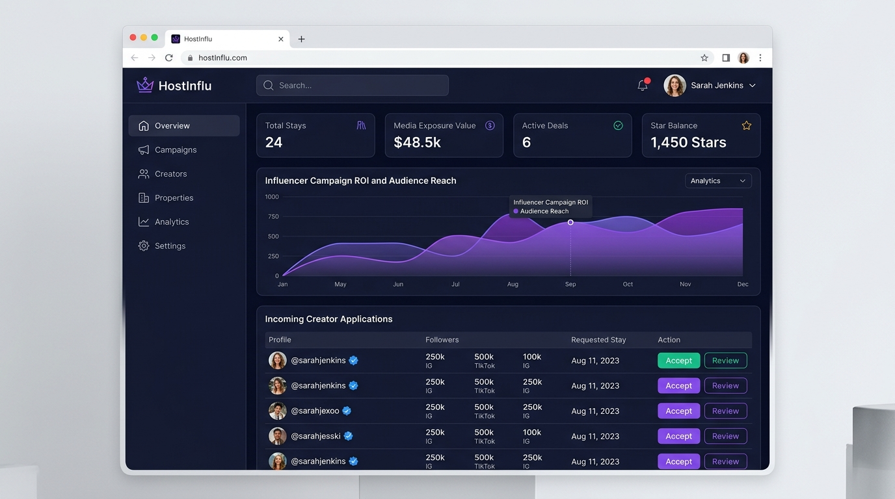
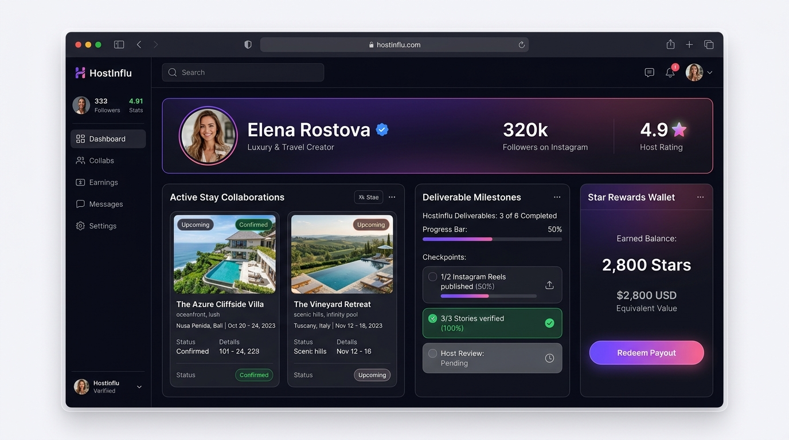
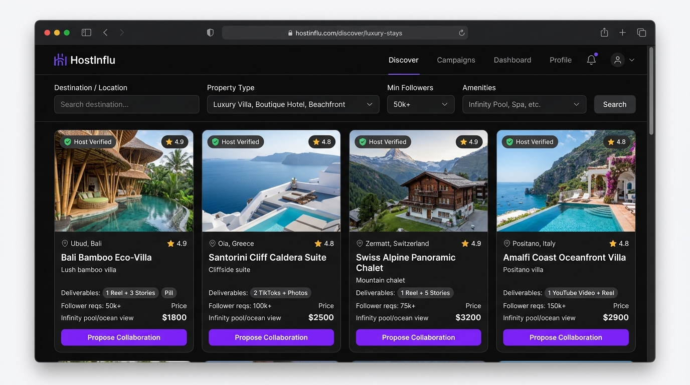
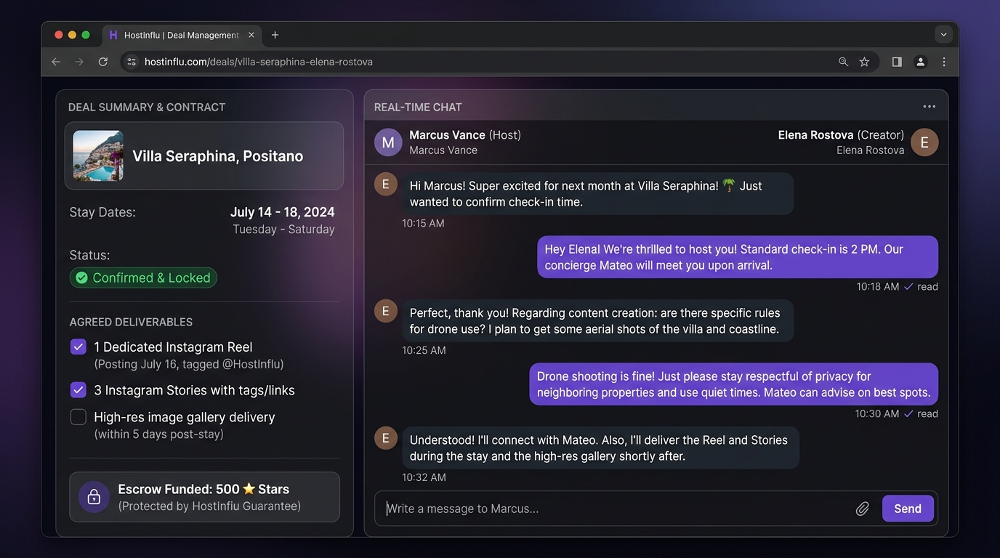

<div align="center">

<!-- Hero Banner & Header Logo -->
<a href="https://github.com/TAIJULAMAN/hostinflu-website">
  
</a>

<br />
<br />

<a id="overview"></a>

# HostInflu — Where Hospitality Meets Influence

**A premier marketplace and dual-sided collaboration ecosystem connecting property hosts with social media creators for authentic experiential stays, automated deal workflows, real-time messaging, and star-based reward payouts.**

<br />

<a id="tech-stack"></a>

<!-- Tech Stack Badges (for-the-badge style) -->

[](https://nextjs.org/)
[](https://react.dev/)
[](https://www.typescriptlang.org/)
[](https://tailwindcss.com/)
[](https://redux-toolkit.js.org/)
[](https://socket.io/)
[](https://www.chartjs.org/)
[](https://www.radix-ui.com/)
[](https://zod.dev/)
[](#license)

<br />

<a id="cta-links"></a>

<!-- Live Demo & CTA Links -->
<p align="center">
  <a href="https://hostinflu.com"><b>Explore Live</b></a> &nbsp;•&nbsp;
  <a href="#architecture"><b>Architecture</b></a> &nbsp;•&nbsp;
  <a href="#core-features"><b>Core Features</b></a> &nbsp;•&nbsp;
  <a href="https://github.com/TAIJULAMAN/hostinflu-website/issues"><b>Report Bug</b></a> &nbsp;•&nbsp;
  <a href="https://github.com/TAIJULAMAN/hostinflu-website/issues"><b>Request Feature</b></a>
</p>

<br />

<!-- Hero Banner Graphic -->


</div>

---

## Table of Contents

- [ Title & Value Proposition](#overview)
- [ Tech Stack Badges](#tech-stack)
- [ Live Demo & CTA Links](#cta-links)
- [ Interface Preview](#interface-preview)
- [ Core Features & Role Portals](#core-features)
  - [ Host Property Hub & Listing Management](#host-hub)
  - [ Influencer Talent & Portfolio Showcase](#influencer-hub)
  - [ Collaboration Proposal & Deal Pipeline](#deal-pipeline)
  - [ Star-Based Rewards & Transaction Escrow](#star-rewards)
  - [ Real-Time Chat & Notification Engine](#realtime-chat)
  - [ Analytics, Reach & ROI Tracking](#analytics-roi)
  - [ Public Discovery, Onboarding & Referrals](#discovery-referrals)
- [ Engineering Highlights & Architecture](#architecture)
  - [ System Architecture Overview](#system-architecture)
  - [ Dual-Role Collaboration & RBAC Matrix](#rbac-matrix)
- [ Project Directory Structure](#project-structure)
- [ Developer Info & Socials](#developer-info)
- [ License & Proprietary Notice](#license)

---

<a id="interface-preview"></a>


## Interface Preview

Explore dedicated host workspaces, verified creator portfolios, and collaborative deal pipelines built with Next.js 16, Tailwind CSS 4, Radix UI, Chart.js, and Socket.io.

|                                  **Host Dashboard & Campaign Analytics**                                  |                                     **Influencer Collaboration Hub**                                      |
| :-------------------------------------------------------------------------------------------------------: | :-------------------------------------------------------------------------------------------------------: |
|       |   |
|                    _Executive metrics, stays management & campaign exposure tracking_                     |                _Verified creator portfolio, active stay milestones & star rewards wallet_                 |

|                                     **Luxury Stay & Property Discovery**                                      |                                   **Real-Time Deal Management & Chat**                                    |
|   :-------------------------------------------------------------------------------------------------------:   | :-------------------------------------------------------------------------------------------------------: |
|  |           |
|                    _Curated luxury villas, amenities & direct collaboration applications_                     |                _Real-time messaging, stay itinerary coordination & star-escrow protection_                |

---

<a id="core-features"></a>

## Core Features & Role Portals

HostInflu bridges property owners and digital creators through specialized, persona-tailored portals designed for mutual trust and maximum promotional ROI.

<a id="host-hub"></a>

### **Host Property Hub & Listing Management**

- **Multi-Property Management**: List villas, boutique hotels, apartments, and luxury cabins with detailed descriptions, photo galleries, and house rules.
- **Amenity & Availability Control**: Specify available dates, minimum stay durations, guest capacities, and included perks.
- **Creator Discovery Engine**: Search and filter vetted influencers by niche (travel, lifestyle, food, fashion), audience demographics, and follower size.
- **Inquiry & Proposal Oversight**: Review inbound collaboration applications, evaluate creator pitch decks, and send formal stay invitations.

<a id="influencer-hub"></a>

### **Influencer Talent & Portfolio Showcase**

- **Verified Creator Profile**: Highlight Instagram, TikTok, and YouTube metrics including average engagement rates, follower counts, and audience demographics.
- **Portfolio Showcase**: Display previous hospitality brand collaborations, high-performing reels, and aesthetic photography.
- **Application Tracker**: Apply directly to open property stays, propose deliverable packages (e.g., 2 Reels + 5 Stories), and monitor application status.
- **Public Shareable Link (`/dashboard/share-profile`)**: Generate branded media kits and social profile links to share directly with prospective hosts.

<a id="deal-pipeline"></a>

### **Collaboration Proposal & Deal Pipeline**

- **End-to-End Proposal Lifecycle**: Structured negotiation covering Draft, Pending Host Review, Counter-Offer, Confirmed, In Progress, and Completed.
- **Deliverable Milestone Verification**: Automated checklist ensuring agreed deliverables (posts, reviews, tags) are verified before closing collaborations.
- **Peer Review & Rating System**: Double-blind mutual review system ensuring accountable stays and professional content production.

<a id="star-rewards"></a>

### **Star-Based Rewards & Transaction Escrow**

- **Gamified Star Economy**: Star-based currency used to fund stay exchanges, creator compensation, and platform perks.
- **Escrow Security**: Star balances remain secured in escrow throughout the stay until all agreed deliverables are fulfilled.
- **Redemption & Payout Pipeline (`/dashboard/influencer-transactions`)**: Influencers convert accumulated stars into monetary payouts with transparent audit histories.

<a id="realtime-chat"></a>

### **Real-Time Chat & Notification Engine**

- **WebSocket Direct Messaging (`/dashboard/chat`)**: Sub-second direct messaging between hosts and creators powered by `socket.io-client`.
- **Media & Attachment Sharing**: Exchange location coordinates, check-in instructions, and content drafts securely.
- **Live Push Notifications (`/dashboard/notifications`)**: Instant alerts for new messages, proposal acceptances, stay confirmations, and payout updates.

<a id="analytics-roi"></a>

### **Analytics, Reach & ROI Tracking**

- **Host Campaign Analytics**: Interactive graphs powered by Chart.js and Recharts visualizing post impressions, content reach, and booking referral clicks.
- **Influencer Growth Metrics**: Historical tracking of completed stays, average partner satisfaction rating, and star earnings over time.

<a id="discovery-referrals"></a>

### **Public Discovery, Onboarding & Referrals**

- **Interactive Public Marketplace**: Public directories for verified hosts (`/hosts`), vetted influencers (`/influencers`), and open opportunities (`/deals`).
- **Guided Onboarding Wizard (`/dashboard/onboarding`)**: Frictionless onboarding guiding new users through profile verification and listing publication.
- **Referral Program (`/dashboard/referrals`)**: Personalized referral links rewarding creators and hosts for onboarding new community members.

---

<a id="architecture"></a>

## Engineering Highlights & Architecture

<a id="system-architecture"></a>

### System Architecture Overview

HostInflu utilizes Next.js 16 App Router, a unified Redux Toolkit store with RTK Query API slices, and real-time Socket.io bi-directional communications.

```
+-----------------------------------------------------------------------------------+
|                        Client & Presentation Layer (Browser)                      |
|   Next.js 16 App Router | React 19 | Tailwind CSS 4 | Radix UI | Chart.js         |
+-----------------------------------------------------------------------------------+
                                          │
                    ┌─────────────────────┴─────────────────────┐
                    ▼ (Type-safe RTK Query Hooks)               ▼ (WebSocket Transport)
+---------------------------------------------+   +---------------------------------+
|          State & API Gateway Layer          |   |       Real-Time Event Bus       |
|   Redux Toolkit | Redux Persist | baseApi   |   |   Socket.io Client | Chat & Push|
+---------------------------------------------+   +---------------------------------+
                    │                                           │
                    ▼ (REST API / JWT Authorization)            ▼ (WSS Events)
+-----------------------------------------------------------------------------------+
|                           Backend API & Microservices                             |
|   Express API | Socket.io Server | Collaboration Pipeline | Star Escrow Engine    |
+-----------------------------------------------------------------------------------+
                                          │
                                          ▼
+-----------------------------------------------------------------------------------+
|                        Database & Media Infrastructure                            |
|   Database Isolation | S3 / Cloudinary Media Storage | Notification Dispatch      |
+-----------------------------------------------------------------------------------+
```

<a id="rbac-matrix"></a>

### Dual-Role Collaboration & RBAC Matrix

| Platform Action & Domain     | Public Visitor | Verified Influencer | Property Host | Platform Admin |
| :--------------------------- | :------------: | :-----------------: | :-----------: | :------------: |
| **Browse Hosts & Creators**  |  Full Access   |     Full Access     |  Full Access  |  Full Access   |
| **Submit Stay Application**  |       ❌       |     Full Access     |      ❌       |       ❌       |
| **Create Property Listing**  |       ❌       |         ❌          |  Full Access  |  Full Access   |
| **Review Proposals & Deals** |       ❌       |   Own Deals Only    | Own Listings  |  Full Access   |
| **Real-Time Live Chat**      |       ❌       |     Full Access     |  Full Access  | Monitor/Audit  |
| **Star Earnings & Escrow**   |       ❌       |    Earn & Redeem    |  Fund Escrow  | Oversee/Refund |
| **Analytics & ROI Charts**   |       ❌       |  Creator Analytics  | Host Reports  | Global Trends  |
| **User Verification CMS**    |       ❌       |         ❌          |      ❌       |  Full Access   |

---

<a id="project-structure"></a>

## Project Directory Structure

```plaintext
hostinflu-website/
├── app/                                # Next.js 16 App Router (Core Application Routes)
│   ├── (auth)/                         # Authentication flows (login, register, forgot-password, OTP)
│   ├── about-us/                       # Platform story, mission & executive vision
│   ├── apply-collaboration/            # Public creator application form for property stays
│   ├── collaboration-request/          # Host collaboration inquiry & proposal submission
│   ├── contact-us/                     # Customer support & general partnership inquiries
│   ├── dashboard/                      # Multi-portal user and administrative dashboard
│   │   ├── chat/                       # Real-time WebSocket messaging interface (Socket.io)
│   │   ├── collaborations/             # Active, pending & past collaboration pipeline
│   │   ├── favourite/                  # Bookmarked properties & creator wishlists
│   │   ├── influencer/                 # Influencer executive dashboard (stars, collaborations, reach)
│   │   ├── influencer-transactions/    # Influencer star rewards, earnings & payout ledger
│   │   ├── lists/                      # Host property listings management & calendar
│   │   ├── notifications/              # Real-time alerts, deal updates & system notifications
│   │   ├── onboarding/                 # Multi-step host & influencer onboarding wizard
│   │   ├── referrals/                  # Referral link generator & commission tracker
│   │   ├── reviews/                    # Verified ratings & testimonials management
│   │   ├── share-profile/              # Public profile shareable links & social preview cards
│   │   ├── transactions/               # Host financial ledger, star purchases & receipts
│   │   ├── layout.tsx                  # Dashboard layout shell with responsive sidebar navigation
│   │   └── page.tsx                    # Host primary dashboard (analytics, incoming requests)
│   ├── deals/                          # Curated public stay deals & collaboration opportunities
│   ├── faq/                            # Frequently asked questions & help center
│   ├── hosts/                          # Public searchable directory of verified property hosts
│   ├── influencers/                    # Public searchable directory of vetted content creators
│   ├── privacy-and-policy/             # Privacy policy & data protection terms
│   ├── profile/                        # User account settings, credentials & social links
│   ├── terms-and-conditions/           # Platform terms of service & deal guidelines
│   ├── globals.css                     # Global styles & Tailwind CSS v4 variables
│   ├── layout.tsx                      # Root layout with theme provider & font declarations
│   └── page.tsx                        # Public landing page (Hero, Deals, Top Creators, CTA)
├── components/                         # React UI & atomic design components
│   ├── commom/                         # Shared navigation bars, headers, footers & modals
│   ├── dashboard/                      # Dashboard charts, metrics cards, tables & widgets
│   ├── landing/                        # Landing page presentation sections & testimonials
│   └── ui/                             # Radix UI & Shadcn primitives (Dialog, Dropdown, Tabs)
├── config/                             # Global application runtime configuration
├── contexts/                           # React Context providers (AuthContext, ThemeContext)
├── hooks/                              # Custom React business logic & utility hooks
├── lib/                                # Core utilities, CSS class mergers (cn) & helpers
├── public/                             # Public static assets (logos, heroes, avatars)
│   └── preview/                        # High-resolution UI mockup previews (Host & Influencer dashboards)
├── Redux/                              # Centralized Redux Toolkit state management
│   ├── api/                            # RTK Query modular API slices
│   │   ├── about/                      # About page dynamic content API
│   │   ├── admin/                      # Platform administration & approval endpoints
│   │   ├── auth/                       # Authentication, token refresh & session API
│   │   ├── bookmark/                   # Property bookmarking & saved listings API
│   │   ├── chat/                       # Conversation threads & message history API
│   │   ├── collaboration/              # Proposal negotiation, approvals & deal lifecycle API
│   │   ├── contact/                    # Contact message dispatch API
│   │   ├── dashboard/                  # Host & influencer KPI metrics endpoints
│   │   ├── faq/                        # Frequently asked questions endpoints
│   │   ├── host/                       # Host profile, properties & preferences API
│   │   ├── influencer/                 # Influencer portfolio, metrics & social handles API
│   │   ├── listings/                   # Property CRUD, amenities & availability API
│   │   ├── notification/               # Real-time notification mark-as-read API
│   │   ├── onboarding/                 # Creator & host onboarding step synchronization
│   │   ├── payments/                   # Star purchase & payment gateway handlers
│   │   ├── refearl/                    # Referral code generation & tracking API
│   │   ├── review/                     # Feedback submission & verified reviews API
│   │   ├── transaction/                # Financial ledgers & payout request API
│   │   ├── user/                       # User profile & account preferences API
│   │   └── baseApi.js                  # Centralized RTK Query baseApi with auth headers
│   ├── Slice/                          # Redux synchronous state slices (authSlice, listSlice)
│   ├── ReduxProvider.jsx               # Client-side store hydration wrapper
│   └── store.js                        # Redux store configuration with redux-persist
├── services/                           # External services & third-party integrations
├── styles/                             # Custom typography & animations
├── utils/                              # Formatters, currency helpers & token parsers
├── .env                                # Environment variable declarations
├── components.json                     # shadcn/ui configuration manifest
├── next.config.mjs                     # Next.js compiler & routing configuration
├── nixpacks.toml                       # Nixpacks deployment configuration
├── package.json                        # Project dependencies, scripts & metadata
├── postcss.config.mjs                  # PostCSS plugins for Tailwind CSS v4
└── tsconfig.json                       # TypeScript compiler options & paths
```

---

<a id="developer-info"></a>

## Developer Info & Socials

HostInflu is created and maintained by full-stack software engineers specializing in marketplace architectures, real-time communications, and creator economy platforms.

- **Md Shah Aman Patwary** — _Lead Full-Stack Software Engineer & Maintainer_
  - 🌐 GitHub: [@TAIJULAMAN](https://github.com/TAIJULAMAN)
  - 📧 Email: [mdshahamanpatwary@gmail.com](mailto:mdshahamanpatwary@gmail.com)

- **Ahteshamul Hasan** — _Full-Stack Engineer & Core Contributor_
  - 📧 Email: [ahteshamulhasan2@gmail.com](mailto:ahteshamulhasan2@gmail.com)

---

<a id="license"></a>

## License & Proprietary Notice

Copyright © 2026 HostInflu. All rights reserved.

This software, including its visual interface, real-time messaging architecture, and creator matchmaking algorithms, is private and proprietary. Unauthorized copying, distribution, decompilation, or commercial exploitation without prior written consent from HostInflu is strictly prohibited.

<div align="center">
  <b>Built with 💜 for authentic travel experiences and seamless creator partnerships</b>
</div>
